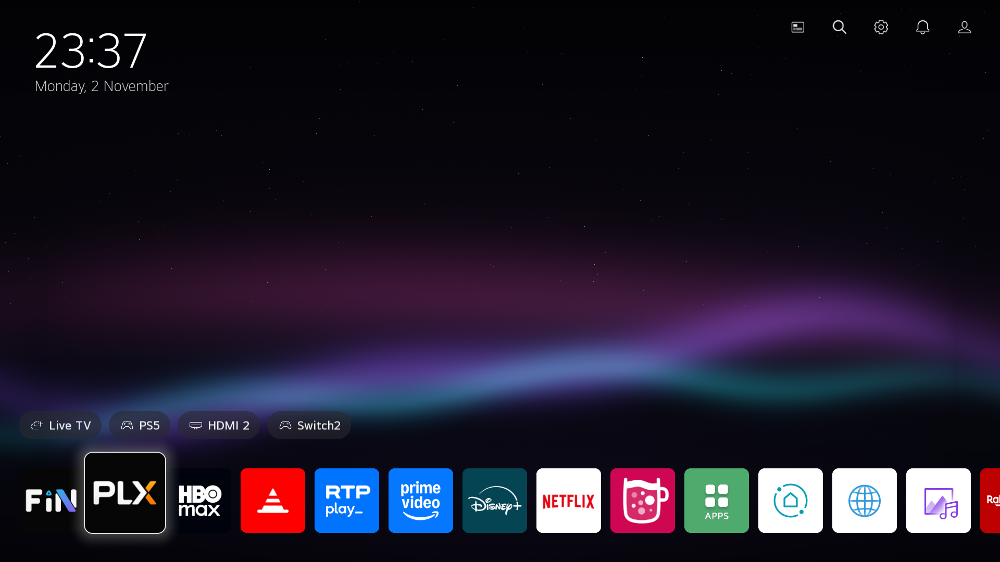
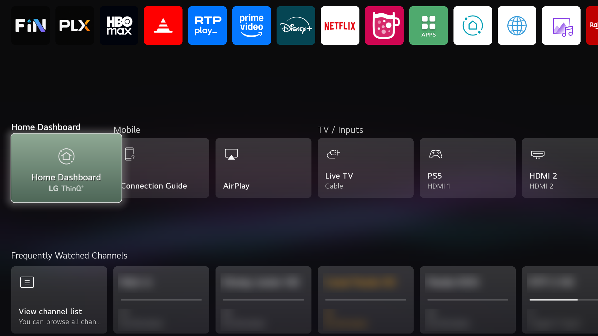
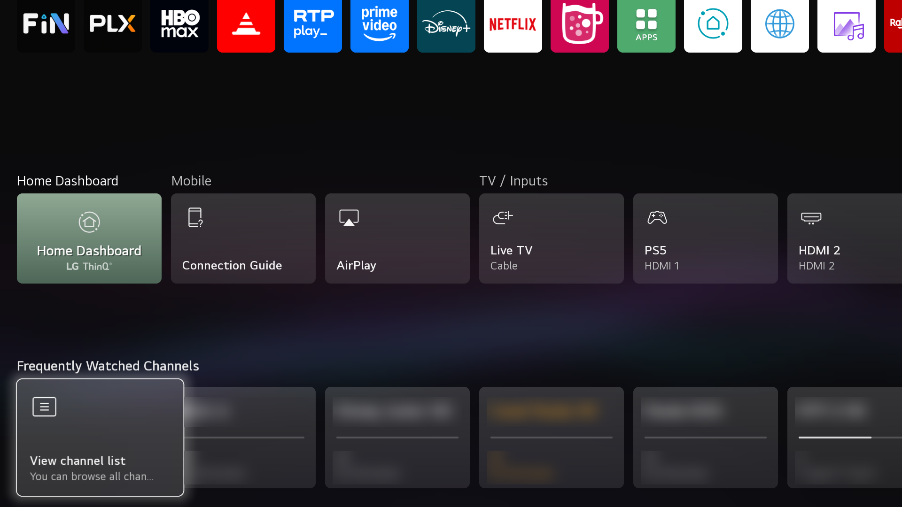
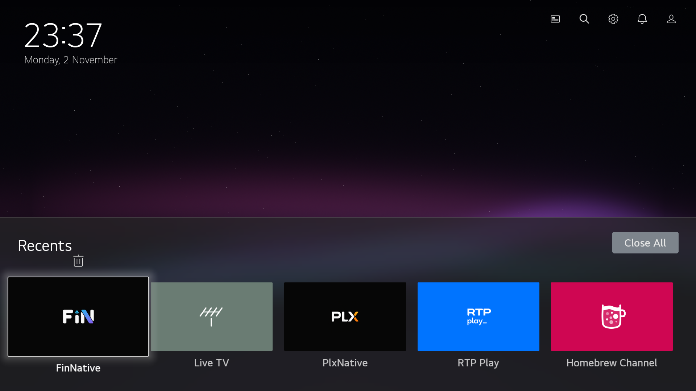
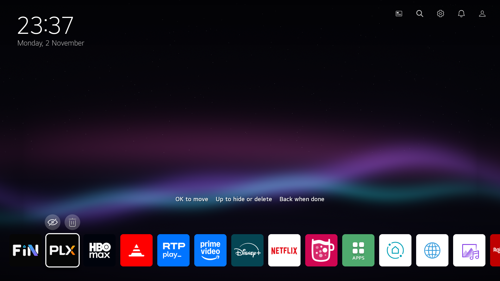

# Home Native

A fast, native replacement for the home screen of rooted LG webOS TVs. It is written in C on
SDL2 and OpenGL ES 2, with no QML, JavaScript or web engine. It looks and behaves like LG's own
webOS 6 Home, with a few additions of its own, and uses a fraction of the memory.

> [!IMPORTANT]
> This is an independent, unofficial project. It is **not affiliated with, endorsed by or
> supported by LG Electronics**. It needs a rooted TV and replaces a system component, which
> may void your warranty. Use it at your own risk: see [Legal](#legal).



| | |
|---|---|
|  |  |
|  |  |

## Why

LG's Home is a large QML app that stays resident: on an LG C1 it takes about 108 MB (68 MB
proportional), partly swapped out, so it often comes back slowly. Home Native draws the same
screen straight on the GPU.

| Home open | LG's Home | Home Native |
|---|---|---|
| Resident memory (RSS) | 108 MB | 39 MB |
| Proportional (PSS) | 68 MB | 12 MB |
| Swap | 35 MB | none |
| Free memory for apps | 698 MB | 783 MB |

## What it does

These follow LG's own layout, measured off its screen and its QML:
- the app row, with LG's edit mode (move and delete apps)
- input pills
- the top buttons (guide, search, settings, notifications, account)
- the dashboard (Home Dashboard, Mobile, TV / Inputs)
- frequently watched channels with the programme on now
- Recents on Back

Its own additions:
- **Hide apps.** In edit mode, press Up over a tile for the eye button. Hidden apps leave the
  row and come back dimmed in edit mode, where you can show them again.
- **Frosted glass.** A blurred copy of the wallpaper sits behind the dashboard and Recents.
- **Livelier focus.** App tiles zoom on a spring and glow in the app's own colour. Long card
  titles scroll.
- **Your own wallpaper.** Put an image at `/var/lib/homenative/wallpaper.png` (or `.jpg`).
- **Screen saver on demand.** Hold the blue button.
- **OLED care.** After a minute with no input Home dims (the first key only wakes it), and the
  clock moves a few pixels each minute.
- **A shorter page.** LG's Browser card and footer buttons are left out: they repeat the top
  buttons and the app row, and the page now ends after the channels.

It's built for TVs that stay in Quick Start+ standby for weeks:
- textures are freed when unused
- images decode off the main thread
- the log has a size limit
- system subscriptions reconnect if they drop
- it does almost nothing while hidden

## Requirements

- An LG TV with **webOS 6** (developed and tested on an **LG C1**, webOS 6.5.3). Other webOS 6
  models may work. Older or newer webOS versions will need changes.
- **Root** and the **[Homebrew Channel](https://github.com/webosbrew/webos-homebrew-channel)**,
  with SSH enabled (for example after rooting with
  [RootMyTV](https://rootmy.tv) or [faultmanager-autoroot](https://github.com/throwaway96/faultmanager-autoroot)).
- A computer on the same network to copy the files over.

UI text comes in English, Portuguese, Spanish, French, German and Italian, picked from the TV's
language. App, input and channel names come from the TV itself, in its fonts. Arabic and Hebrew
names show their letters, but not joined up or right to left.

## Install

1. Download `homenative-<version>.tar.gz` from the [Releases](../../releases) page.
2. Copy it to the TV and unpack it:

   ```bash
   scp -O homenative-0.2.0.tar.gz root@<tv-ip>:/tmp/
   ssh root@<tv-ip> 'cd /tmp && tar xzf homenative-0.2.0.tar.gz'
   ```

   `-O` makes `scp` use its classic protocol: the TV's SSH server (Dropbear) has no SFTP, which
   newer `scp` uses by default and then hangs.

3. Install the app and its boot hook, then reboot:

   ```bash
   ssh root@<tv-ip> 'sh /tmp/homenative-0.2.0/install.sh && reboot'
   ```

   To upgrade later, run `install.sh` the same way, without the reboot. It switches to the new
   build in place.

From then on Home Native is the TV's Home. It's on screen about 45 seconds after a cold boot,
and the Home key opens it instantly. Nothing on the TV's read-only system partition is changed.

### Your own wallpaper

```bash
scp -O my-wallpaper.png root@<tv-ip>:/var/lib/homenative/wallpaper.png
```

Use 1920 × 1080 in PNG or JPEG. It's picked up the next time Home starts (reboot, or run
`kill $(pidof com.webos.app.home)` on the TV). Dark images suit an OLED best. Delete the file
to go back to the built-in one.

## Using it

| Key | Does |
|---|---|
| Arrows, OK | move, open |
| Down from the apps | the dashboard: inputs and channels |
| Back on the home screen | Recents (Up, then OK, closes the app under it) |
| Long press OK on an app | edit mode: OK picks an app up to move it, Up shows hide and delete |
| Home | back to the home screen, from anywhere |
| Hold blue | LG's screen saver (the dim clock), handy on an OLED |

## Turning it off

- **For a while:** `touch /var/lib/homenative/disabled`, then reboot. LG's Home comes back;
  delete the file and reboot to return.
- **LG's Home right now, without rebooting:** `sh /var/lib/homenative/restore.sh`. A reboot
  brings Home Native back.
- **Remove it completely:** `sh /var/lib/homenative/uninstall.sh`. LG's Home comes back, and
  this removes the app, the boot hook and `/var/lib/homenative`, including your hidden list and wallpaper.

The installer copies `restore.sh` and `uninstall.sh` to `/var/lib/homenative/`, because the
TV empties `/tmp` at every boot.

## How it works

The app installs as an ordinary Developer Mode app. The boot hook `10-homenative` runs from
Homebrew Channel's `init.d`, about 40 seconds after boot. It:

1. bind-mounts the app's binary over `/usr/bin/com.webos.app.home`;
2. covers Home's CRIU checkpoint with an empty read-only tmpfs, so the system starts the binary
   fresh instead of restoring LG's saved process;
3. closes LG's Home and preloads Home Native hidden in the background.

The changes are mounts made at boot, so a reboot without the hook undoes them completely.

Home Native is the only Home on the TV while it runs, so it looks after itself. If it starts four
times in a row, each lasting under ten minutes, without being told to quit, it lifts its mounts and becomes LG's Home in the same
process, and the hook won't mount that build again until a different one is installed. A watchdog
kills it if the main loop stops for 90 seconds, which counts as one of those starts. The previous
log is kept at `/tmp/homenative.log.prev`, with a backtrace if it crashed.

As Home, the binary registers on the system bus as `com.webos.app.home`, which inherits Home's
permissions. It also subscribes to `applicationManager/registerApp`, so each Home key press
arrives as a "relaunch" event instead of a process restart.

LG's own icons and images (input icons, the trash, the dashboard artwork) are read from the TV's
system partition at run time. None are in this repository.

## Building

You need the webOS NDK: the `arm-webos-linux-gnueabi_sdk-buildroot` toolchain from
[openlgtv/buildroot-nc4 releases](https://github.com/openlgtv/buildroot-nc4/releases). Unpack it to
`~/webos-ndk` and run its `relocate-sdk.sh` (or point `WEBOS_SDK=` at it elsewhere).

```bash
make        # pkg/homenative
make ipk    # io.github.tiper.homenative_<version>_arm.ipk
make dist   # dist/homenative-<version>.tar.gz: the ipk, the hook and the scripts
```

The wallpaper and icons are drawn by `art/generate.py` (plain Python, no dependencies).

GitHub Actions ([`.github/workflows/build.yml`](.github/workflows/build.yml)) builds every push
and pull request with a pinned NDK release, and keeps the tarball and ipk as build artifacts.
To publish a release, set the version in `pkg/appinfo.json` and push a matching tag:

```bash
git tag v0.1.0 && git push origin v0.1.0
```

| Path | What |
|---|---|
| `src/home.c` | the whole launcher |
| `hook/10-homenative` | the boot hook that makes it the system Home |
| `scripts/` | `install.sh`, `uninstall.sh`, `restore.sh`, run on the TV |
| `scripts/dev/` | development checks and screenshot scripts (see [TESTING.md](TESTING.md)) |
| `pkg/` | appinfo, icons and wallpaper; the build puts the binary here |
| `art/` | the generator of the wallpaper and icons |
| `vendor/` | [cJSON](https://github.com/DaveGamble/cJSON) (MIT) |

### Development flags

These are read when Home starts:
- `/var/lib/homenative/verbose` logs every system call and image load to
  `/tmp/homenative.log`. The log restarts past 512 KB either way.
- `/var/lib/homenative/dev` takes key names from `/tmp/nh-cmd`, for scripted checks. It's
  always on in the separate dev app, which lets you try a build without rebooting. The dev
  app logs to `/tmp/homenative-dev.log`, since it runs as an app user and cannot write Home's log.

## Licence

[GPL-3.0-or-later](LICENSE). cJSON is MIT-licensed.

## Legal

- **Unofficial.** Home Native is an independent project. It is not affiliated with, endorsed
  by, sponsored by or supported by LG Electronics. Please don't contact LG about it.
- **Trademarks.** LG, webOS, ThinQ and Quick Start+ are trademarks of LG Electronics. They are
  named here only to say which TVs and features this works with. App names and logos in the
  screenshots belong to their owners.
- **No LG code or artwork is included.** The launcher is written from scratch. It reproduces
  the layout of LG's home screen for familiarity, so it fits in with the rest of the TV. LG's
  icons and images are not in this repository; Home Native reads them from your own TV's
  system partition at run time. The wallpaper and icon it ships are original, generated by
  `art/generate.py`.
- **No warranty.** It runs on a rooted TV and replaces the system Home. That may void your
  warranty, and you use it entirely at your own risk. As the GPL says, it comes with no
  warranty of any kind. Every change it makes can be undone (see
  [Turning it off](#turning-it-off)), and nothing on the TV's read-only system partition is
  modified.
